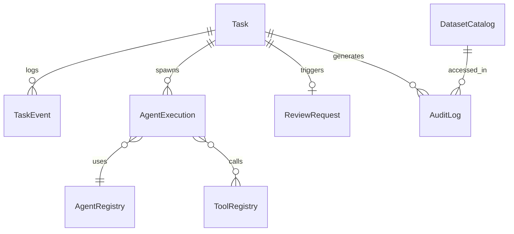

# 11. 데이터 모델 및 ERD (Data Model and ERD)

## 1. 개요
플랫폼의 메타데이터, 태스크 상태, 검증 이력, 레지스트리를 관리하기 위한 관계형 데이터베이스(PostgreSQL)의 논리적 데이터 모델을 정의합니다. 원천 공간 데이터나 시계열 데이터 자체의 스키마는 각 저장소(PostGIS, Object Storage 등)의 규격을 따르며, 여기서는 **플랫폼 운영 데이터**에 집중합니다.

## 2. 주요 엔터티 및 관계

### 2.1 Task & Execution (태스크 실행 추적)
- **Task**
  - `task_id` (PK)
  - `user_id`
  - `organization_id`
  - `original_query`
  - `status` (RECEIVED, EXECUTING, COMPLETED, FAILED 등)
  - `created_at`, `updated_at`
- **TaskEvent (상태 전이 이력)**
  - `event_id` (PK)
  - `task_id` (FK)
  - `previous_state`, `next_state`
  - `reason`
  - `timestamp`
- **AgentExecution (각 Agent 호출 이력)**
  - `execution_id` (PK)
  - `task_id` (FK)
  - `agent_name`
  - `status`
  - `execution_time_ms`
  - `result_summary`

### 2.2 Registry (레지스트리 관리)
- **AgentRegistry**
  - `agent_id` (PK)
  - `name`, `version`, `endpoint`, `health_status`
- **ToolRegistry**
  - `tool_id` (PK)
  - `name`, `version`, `input_schema` (JSONB), `output_schema` (JSONB), `security_scope`
- **ModelRegistry**
  - `model_id` (PK)
  - `name`, `version`, `task_type`, `endpoint`
- **DatasetCatalog (데이터셋 메타데이터)**
  - `dataset_id` (PK)
  - `logical_name`
  - `physical_location`
  - `spatial_extent` (Geometry)
  - `temporal_extent` (Tstzrange)
  - `security_level`

### 2.3 Review & HITL (검토 및 인더루프)
- **ReviewRequest**
  - `review_id` (PK)
  - `task_id` (FK)
  - `requested_reason`
  - `status` (PENDING, APPROVED, REJECTED, REVISED)
  - `reviewer_id`
  - `comments`
  - `created_at`, `resolved_at`

### 2.4 Audit & Security (감사 로그)
- **AuditLog**
  - `log_id` (PK)
  - `task_id`, `user_id`
  - `action_type` (TOOL_CALL, DATA_ACCESS, MAP_GENERATE)
  - `resource_id`
  - `timestamp`

## 3. ERD (Mermaid)

## 4. 데이터베이스 및 확장 관리
- **Alembic**: 데이터베이스 스키마 마이그레이션 관리.
- **pgvector**: 문서(표준/법령) RAG 검색용 벡터 저장은 별도의 `document_embeddings` 테이블(스키마 생략)에 구성.
- **Partitioning**: `TaskEvent`와 `AuditLog`는 대용량이 되므로 `timestamp` 기준 월별(Monthly) 테이블 파티셔닝 적용.
