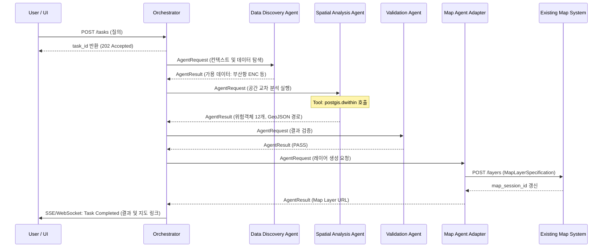
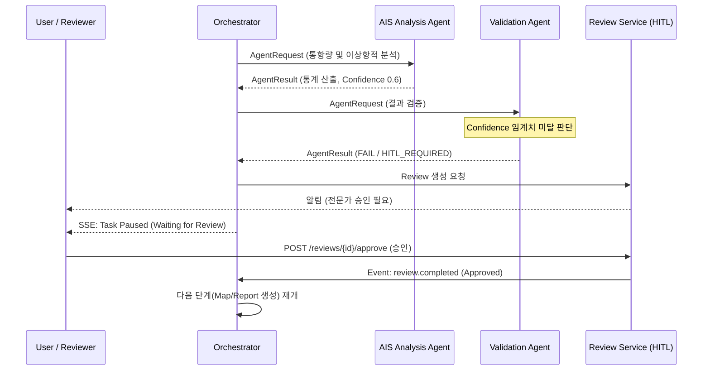

# 13. 시퀀스 다이어그램 (Sequence Diagrams)

## 1. 개요
사용자의 질의가 입력된 후 전체 플랫폼이 어떻게 동작하는지 대표적인 E2E 시나리오를 바탕으로 시스템 간 상호작용을 시각화합니다.

## 2. 기본 분석 시나리오 (순차적/병렬 처리 및 Map 생성)

**질의**: "부산항 입구 3km 이내의 위험객체를 분석해줘"

## 3. Human-in-the-Loop (충돌 시나리오)

**상황**: Agent 결과에 불확실성이 높아 Validation이 실패하거나 정책적 판단이 필요한 경우.

## 4. 시계열 및 RAG 병렬 처리 시나리오
**질의**: "해상풍력 후보지를 주변 수심과 법적 보호구역 측면에서 평가해줘."
이 경우 `Spatial Analysis Agent`와 `Standard·RAG Agent`가 동시에 병렬로 실행되며, 결과를 `Situation Interpretation Agent`가 종합합니다. (자세한 시퀀스는 생략하나, Ochestrator의 DAG 병렬 분기 로직이 적용됨)
